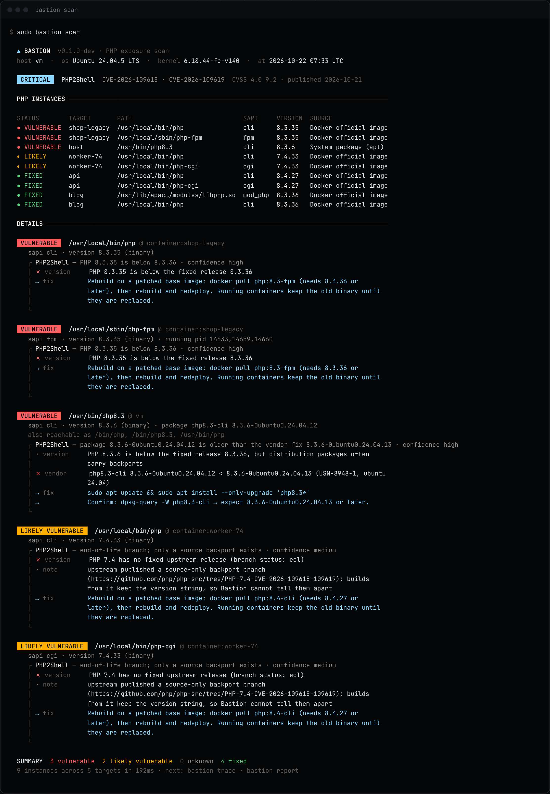

<div align="center">

# Bastion

**你的 PHP 还暴露着吗？网站是不是已经被黑了？**

开源、在你自己服务器上运行、**只读不改**的 PHP 安全工具。找出服务器上所有的 PHP——系统软件包、宝塔、cPanel、容器——
告诉你哪些**真的**修复了 **PHP2Shell**（CVE-2026-109618 / CVE-2026-109619），并排查入侵者留下的痕迹。

[官网](https://larptard.github.io/bastion/zh/) ·
[在线自查](https://larptard.github.io/bastion/zh/check/) ·
[原理](https://larptard.github.io/bastion/zh/how-it-works/) ·
[文档](https://larptard.github.io/bastion/zh/docs/) ·
[English](README.md)



<sub><code>bastion scan</code> 的真实输出：Ubuntu 24.04 虚拟机 + 四个官方 PHP 容器，由 <code>scripts/demo/record.sh</code> 录制。</sub>

</div>

## 为什么需要它

**2026 年 10 月 21 日**，PHP 官方为两个引擎漏洞发布了紧急版本（**8.5.12、8.4.27、8.3.36、8.2.35**），
评分 **CVSS v4 9.2**：未授权远程代码执行，已在 Apache mod_php 上演示——甚至发生在应用代码运行之前。
PHP 8.1 及更早版本没有任何官方发布，只有源码回溯分支。

判断“我的服务器安全吗”比想象中难：

- **版本号会说谎。** Ubuntu 24.04 修复后的 PHP 仍显示 `8.3.6`（上游修复版本是 8.3.36）。发行版回溯补丁不改版本号，只看版本号两个方向都会判错。
- **机器上不止一个 PHP。** 系统自带的、面板装的两个版本、上个月构建的容器……
- **文件更新了 ≠ 进程更新了。** php-fpm 和 Apache 在重启前一直运行旧代码。
- **补丁赶不走已经进来的攻击者。**

## 安装

```sh
curl -fsSL https://larptard.github.io/bastion/install.sh | sh
```

支持 Linux 与 macOS（amd64、arm64）。脚本会校验 SHA-256，若安装了 `cosign` 还会校验 Sigstore 签名
（设置 `BASTION_REQUIRE_SIGNATURE=1` 则强制校验）。也可以[手动下载并校验](https://larptard.github.io/bastion/zh/docs/#install)、
`go install github.com/larptard/bastion/cmd/bastion@latest` 或 `make build`。

## 使用

```sh
sudo bastion scan       # 所有 PHP 构建，以及是否真正修复
sudo bastion trace      # Webshell、持久化、日志痕迹 + 时间线
sudo bastion report     # 两者合一，生成单个离线 HTML 报告
php -v | bastion check  # 评估粘贴的输出（与官网在线自查同一引擎）
```

退出码：`0` 正常 · `1` 有漏洞/有入侵迹象 · `2` 无法判断/可疑。`--json` 输出带版本号的结构化结果。
[示例报告 →](https://larptard.github.io/bastion/demo/report.html)

## 判断原理

Bastion **不执行**被检查的二进制，直接从文件中读出版本号（所有 PHP SAPI 都内嵌 `X-Powered-By: PHP/<版本>`），然后逐级判断，拿到证据即停：

1. **上游版本**不低于该分支修复版本 → 已修复；
2. **发行版修复表**：来自 Ubuntu、Debian 安全追踪器的精确修复包版本，按 dpkg 算法比较；
3. **软件包变更日志**写明了 CVE-2026-109618/109619；
4. **补丁指纹**：二进制中含有只有补丁才会引入的代码；
5. 否则：本应有证据却没有 → *很可能存在漏洞*；信息不足 → **无法判断**，绝不瞎猜。

漏洞就是**数据**：[`internal/advisory/data/*.json`](internal/advisory/data/)，新漏洞只需加一个 JSON 文件。
详见[原理页面](https://larptard.github.io/bastion/zh/how-it-works/)（附逐段注释的真实源码）。

## 路线图

| 模块 | | 状态 |
|---|---|---|
| **Sense** 感知 | 盘点与暴露面判断（`scan`、`check`、`report`） | ✅ 已可用 |
| **Trace** 入侵溯源 | 入侵迹象与时间线（`trace`） | ✅ 已可用 |
| **Forge** 补丁锻造 | 基于官方回溯分支为停止维护的 PHP 可复现地构建补丁包 | 🗺 路线图 |
| **Shift** 安全迁移 | 迁移到受支持分支的兼容性检查与演练 | 🗺 路线图 |
| **Guard** 运行时防护 | 实时识别漏洞利用尝试 | 🗺 路线图 |

许可：[MIT](LICENSE) · 安全问题请见 [SECURITY.md](SECURITY.md)
