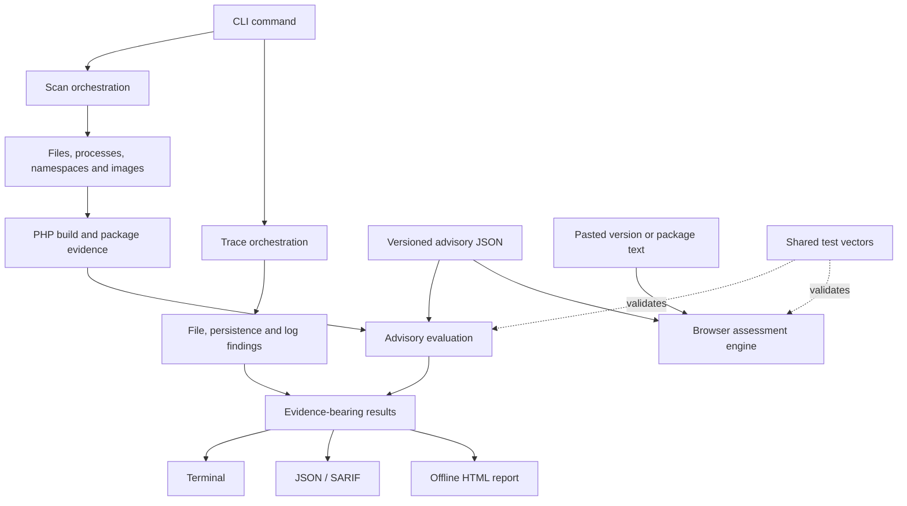

# Architecture

Bastion has two independent investigation paths: patch assessment and intrusion tracing. The CLI renders either path directly or combines their results in an offline report. The browser checker implements assessment rules for pasted input; it does not discover or inspect a host.

## Data flow

## Code map

| Area | Responsibility | Entry point |
| :--- | :--- | :--- |
| CLI | Parse flags, dispatch commands, preserve exit-code semantics | [`internal/cli/`](../internal/cli/) |
| Discovery | Find binaries, processes, installation paths and container targets | [`internal/discover/`](../internal/discover/) |
| Package metadata | Attribute binaries to packages and obtain package evidence | [`internal/pkgdb/`](../internal/pkgdb/) |
| Advisory engine | Load advisory data and evaluate a subject's evidence | [`internal/advisory/evaluate.go`](../internal/advisory/evaluate.go) |
| Scan orchestration | Combine discovery, package evidence, assessments and mitigations | [`internal/scan/scan.go`](../internal/scan/scan.go) |
| Image inspection | Read exported image contents without starting the image | [`internal/imagefs/`](../internal/imagefs/) |
| Configuration | Read relevant PHP configuration for mitigation checks | [`internal/phpini/`](../internal/phpini/) |
| Intrusion tracing | Combine file rules, persistence checks, log findings and timeline | [`internal/trace/trace.go`](../internal/trace/trace.go) |
| Reports | Render a standalone HTML investigation artifact | [`internal/report/`](../internal/report/) |
| SARIF | Convert findings to machine-readable security results | [`internal/sarif/`](../internal/sarif/) |
| Browser engine | Assess pasted input locally | [`site/assets/engine.js`](../site/assets/engine.js) |

## Patch assessment

Discovery produces an instance with its path, PHP version, SAPI, execution target and available metadata. Package attribution adds the package manager, source package and distribution version. Static inspection may add changelog hits, build dates and patch fingerprints.

The advisory engine evaluates that evidence against a versioned advisory. A result includes a status, confidence, explanation and evidence records. It is not merely a comparison between the visible PHP version and the latest upstream release: vendor packages may retain an older upstream version while carrying a fix.

The four assessment states are `fixed`, `vulnerable`, `likely-vulnerable` and `unknown`. Their exact decision order is defined by [`Evaluate`](../internal/advisory/evaluate.go). When changing that order, update shared vectors and the browser engine together.

## Intrusion tracing

Trace collects findings from web-root files, persistence locations and logs. Each finding carries a rule identifier, severity, explanation and available location or timing evidence. The timeline correlates observations; it does not establish causality or attribute an attacker.

Content rules live in [`internal/trace/rules/content.json`](../internal/trace/rules/content.json). Positive fixtures must be inert. Legitimate negative fixtures and the CI false-positive corpus constrain rules that would otherwise match ordinary PHP application code.

## Boundaries that matter

- **Privilege:** unreadable processes and files limit discovery. More privileges increase access, not confidence in the integrity of a compromised host.
- **Platform:** Linux process and namespace inspection relies on `/proc`. macOS coverage does not include those Linux-specific paths.
- **Execution:** static reads are preferred; `scan --no-exec` disables PHP and container-exec identification fallbacks. Image export is a separate runtime-CLI operation.
- **Offline mode:** `--sysroot` redirects filesystem inspection and disables live process/container discovery.
- **Freshness:** advisory data ships with the build. An operator can supply additional data with `--db`; the engine does not infer undocumented vendor fixes.
- **Outputs:** scan and trace JSON schemas are versioned. Exit codes and SARIF mappings are integration contracts, not presentation details.

## Verification map

| Risk | Existing verification |
| :--- | :--- |
| Go and browser disagree | Shared fixtures in [`testdata/`](../testdata/) and [`site/test/`](../site/test/) |
| Package version comparison regresses | Tests in [`internal/version/`](../internal/version/) and [`internal/advisory/`](../internal/advisory/) |
| Discovery misses real installations | Container-backed tests in [`integration/`](../integration/) |
| Trace rules flag ordinary application code | Unit fixtures and the legitimate PHP corpus in [CI](../.github/workflows/ci.yml) |
| Reports or output formats regress | Tests alongside [`internal/report/`](../internal/report/) and [`internal/sarif/`](../internal/sarif/) |
| Website references drift | Build-time relative-link and source-anchor checks |

These are verification mechanisms, not a claim that all current runs pass. Consult [workflow results](https://github.com/BastionPHP/Bastion/actions) for the tested commit and environment.
